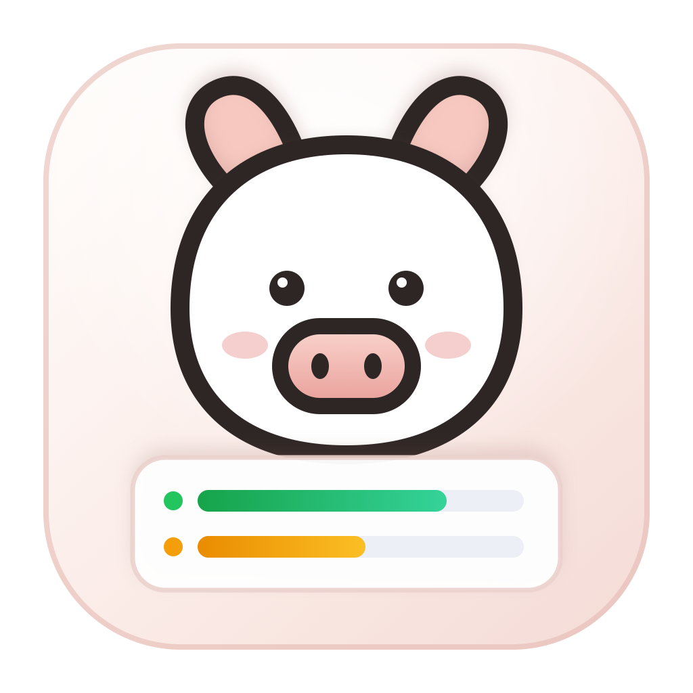
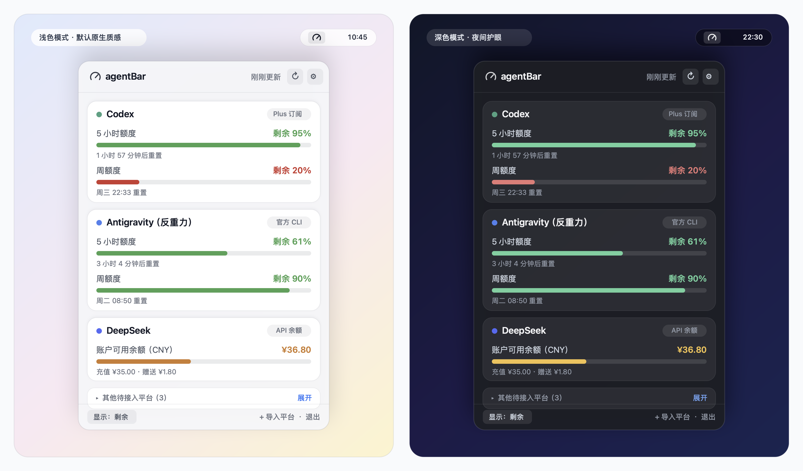

<p align="center">
  
</p>

<h1 align="center">agentBar</h1>

<p align="center">
  <strong>A minimalist macOS menu bar utility for tracking AI Agent quotas</strong><br/>
  One clean icon in your menu bar. One click to see 5-hour limits, weekly caps, and balances across your AI coding agents—native, focused, zero bloat.
</p>

<p align="center">
  <a href="README.md">简体中文</a> &nbsp;|&nbsp; <strong>English</strong>
</p>

<p align="center">
  
  
  
  
</p>

---

## UI Preview & Interactive Prototype

> Defaults to a crisp **Light** native macOS frosted-glass look (`NSVisualEffectView`), with instant switching to **Dark** mode or **System** appearance inside Settings.



- Offline interactive HTML prototype included in the repository: [docs/prototype.html](docs/prototype.html) (open locally in any browser to toggle between synced quota cards, onboarding state, and remaining/used percentages).
- The app bundle uses a light-toned **piggy + dual progress bar** icon ([assets/logo.png](assets/logo.png)), while keeping the menu bar and popover chrome strictly minimal with a clean open-arc gauge template glyph.

---

## Why agentBar? (Minimalist Design Philosophy)

Existing quota monitors like `CodexBar`, `ClaudeBar`, and `CCBar` are feature-rich, yet often overcrowd the dropdown with **recent conversations, billing heatmaps, spend graphs, and multi-tab analytics**, or flood your menu bar with percentages for every tool.

**`agentBar` is built around deliberate restraint:**

1. **Single Menu Bar Icon**: Only one crisp monochrome gauge template icon in the menu bar—no numbers cluttering notch space, no Dock icon.
2. **Clutter-Free Header**: Icon + title on the left; update timestamp, refresh, and settings on the right—nothing else.
3. **Quotas Only**: No recent chat history, no noisy charts. Each card shows only the provider name, plan badge, **6pt green/amber/red progress bars**, and reset countdowns.
4. **Shows Top 3 by Default, Auto-Scrolls Beyond**: Content height adapts cleanly up to `520pt` (fitting 3 full cards at a glance), then smoothly enables scrolling for 4+ providers.
5. **Auto-Collapsed Unused Providers**: Unconfigured or uninstalled agents tuck quietly into a single collapsible drawer at the bottom.
6. **Clean Native Chrome**: The light piggy artwork lives exclusively on the desktop App Icon—inside the UI, everything stays pure native macOS.

---

## Key Features

- **Multi-Agent Auto-Sync**:
  - **Codex**: Automatically reads `~/.codex/auth.json` for real-time 5-hour & weekly quotas, with fast tail-read fallback to `~/.codex/sessions/**/*.jsonl` when offline.
  - **Antigravity**: Syncs via the official `agy` CLI, automatically filtering out third-party Claude/GPT buckets to display only Antigravity's core 5-hour & weekly quotas.
  - **Claude Code**: One-click installation of an official `statusLine` hook (chains cleanly with any existing user script—zero extra API calls, never hits 429).
  - **DeepSeek**: Queries the official `api.deepseek.com/user/balance` endpoint with an inline **Test** button right inside Settings.
  - **Cursor & OpenCode**: Built-in support via API key or custom CLI command.
- **Max-Tier Adaptive Display**: Across Codex, Claude Code, and Antigravity, plans without a 5-hour rolling cap automatically display **Weekly** and **Overall / All** quotas.
- **Drag-and-Drop Reordering + Toggle**: Enable or disable custom provider ordering in Settings, then drag the `≡` handle (or nudge with `↑ / ↓`) to pin your top 3 agents first.
- **Extensible Preset Templates (No Code Needed)**: Built-in one-click templates for **SiliconFlow, Kimi / Moonshot, OpenRouter, custom CLI / OpenCode scripts, and generic HTTP JSON APIs (OneAPI / NewAPI)**.
- **Native Light & Dark Themes**: Synchronizes `NSApp.appearance`, `NSVisualEffectView`, and both popover & Settings windows instantaneously.
- **Built-in CLI Diagnostics**: Run `agentBar --diagnose` to inspect detection and sync status across every provider without ever printing keys or tokens.

---

## Installation & Usage (macOS 14+)

### Option 1: Direct Download (Recommended)

Download the latest release from [**GitHub Releases**](https://github.com/zhixiang-luo/agentBar/releases/latest):

- **`.dmg` Installer (Recommended)**: Download `agentBar-v0.2.0-macos.dmg`, double-click to mount, and drag `agentBar.app` into `Applications`.
- **`.zip` Portable Archive**: Download `agentBar-v0.2.0-macos.zip`, unzip, and double-click `agentBar.app`.

> **First-Launch Gatekeeper Note**: As an indie open-source project without an Apple Developer notarization certificate, macOS may warn on first launch. Clear the quarantine flag once in Terminal, then open normally:
> ```bash
> xattr -cr /Applications/agentBar.app
> ```

### Option 2: Build from Source

> Only Apple **Command Line Tools** are required—no full Xcode installation needed.

```bash
git clone https://github.com/zhixiang-luo/agentBar.git
cd agentBar

# 1. Run all 9 unit tests
./scripts/run-tests.sh

# 2. Build Release & assemble dist/agentBar.app
./scripts/build-app.sh

# 3. Package DMG & ZIP release artifacts (optional)
./scripts/package-release.sh 0.2.0

# 4. Install & launch
cp -R dist/agentBar.app /Applications/
open /Applications/agentBar.app
```

### Quick Provider Setup

| Provider | How to Connect | Effort |
| :--- | :--- | :--- |
| **Codex** | Auto-syncs if signed in locally (inherits macOS system proxy; custom proxy supported in Settings) | Instant |
| **Antigravity** | Install official CLI: `brew install --cask antigravity-cli`, sign in via `agy`, then refresh | ~30s |
| **Claude Code** | Click one-click hook setup inside `agentBar` to sync via official `statusLine` | ~5s |
| **DeepSeek** | Paste API key in Settings → click **Test** → Save & Refresh | ~15s |
| **SiliconFlow / Kimi / OpenRouter / Custom CLI / Relays** | Click `+ Import` in footer → pick a preset → Test & Save | ~15s |

### CLI Diagnostics

```bash
/Applications/agentBar.app/Contents/MacOS/agentBar --diagnose
```

---

## Open Source & Privacy

- **Local-First Privacy**: All configs and API keys live strictly on your machine under `~/.config/agentbar/`. Nothing is sent to third-party servers.
- **Sanctioned Channels Only**: `agentBar` relies strictly on official endpoints, official CLI flags, official hooks, or explicit user configuration—never probing undocumented local host processes or internal ports.
- **License**: Released under the [MIT License](LICENSE).
- **Contributions**: Adding a new built-in provider takes just one Swift file conforming to `QuotaProvider`. See [CONTRIBUTING.md](CONTRIBUTING.md).

---

## Documentation

- [Architecture & Sync Mechanisms](docs/ARCHITECTURE.md)
- [Provider Setup & Custom Extension Guide](docs/PROVIDER_GUIDE.md)
- [Testing & Release Checklist](docs/TESTING.md)
- [Offline Interactive UI Prototype](docs/prototype.html)
- [Contributing Guide](CONTRIBUTING.md)
- [Changelog](CHANGELOG.md)

---

## Roadmap

- [x] **v0.1.0**: Native macOS single-icon menu bar app, 6 built-in providers, custom CLI/HTTP extension engine
- [x] **v0.2.0**: Native Light/Dark vibrancy themes, minimal gauge menu bar icon, light piggy App Icon, 3-card adaptive height with auto-scroll, drag-and-drop sorting, max-tier quota rules, DeepSeek live test, preset templates, and macOS DMG/ZIP releases
- [ ] **v0.3.0**: Launch-at-login toggle, low-quota macOS notifications, additional native providers & full in-app i18n
- [ ] **v1.0.0 (Cross-Platform)**: Tauri v2 + Rust **Windows system tray edition** once macOS UX is rock-solid
