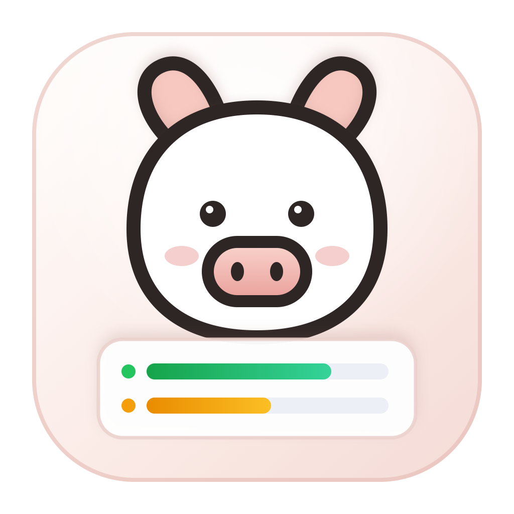
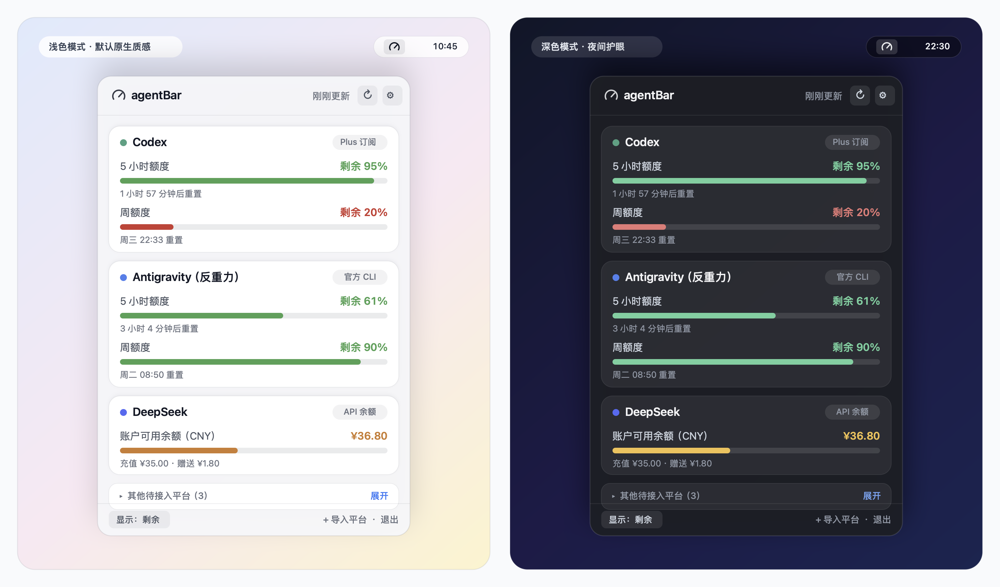

<p align="center">
  
</p>

<h1 align="center">agentBar</h1>

<p align="center">
  <strong>专为中国开发者打造的极简 macOS 菜单栏 AI Agent 额度工具</strong><br/>
  菜单栏只占一个图标，点一下只看各平台的 5 小时额度、周额度与可用余额——零冗余、纯中文、原生质感。
</p>

<p align="center">
  
  
  
  
</p>

---

## UI 展示与交互原型

> 默认采用**浅色模式**，贴近 macOS 原生毛玻璃（`NSVisualEffectView`）与苹果「系统设置」分组卡片质感，并支持在设置中切换**深色模式**或**跟随系统昼夜变化**。



- 仓库内置可离线打开的交互式原型文件：[docs/prototype.html](docs/prototype.html)（下载或克隆仓库后用浏览器直接打开，可点击切换「已同步额度态 / 首次引导态」与「显示剩余 % / 显示已用 %」）。
- 应用桌面图标采用浅色系**小猪 + 双层进度条**设计（[assets/logo.png](assets/logo.png)），与小猪系列工具保持统一视觉；**应用界面内部克制不放 Logo**，菜单栏与面板顶栏均采用极简开口仪表盘图标。

---

## 为什么要做 agentBar？（简约风格说明）

市面上已有 `CodexBar`、`ClaudeBar`、`CCBar` 等优秀工具，但在日常开发中仍然存在几个普遍痛点：
- 下拉面板堆砌了**最近对话记录、复杂费用热力图、账单曲线、多标签报表**，想看一眼“还剩多少额度”反而要扫半天；
- 顶部菜单栏把每个平台的百分比都平铺出来，极占刘海屏空间；
- 默认英文界面，国内常用平台（DeepSeek、硅基流动、Kimi、中转站）接入成本偏高。

**`agentBar` 的核心设计原则就是「克制的减法」——简约体现在 6 个地方：**

1. **菜单栏只占 1 个极简图标**：只放一个极简开口仪表盘 Template 图标（自动适配浅/深菜单栏），不在顶部栏平铺冗长数字，也不占用程序坞（Dock）。
2. **面板顶栏零干扰**：左边图标 + 名称，右边只保留「更新时间 + 刷新 + 设置」，不堆多余切换按钮。
3. **点开只看额度，绝无杂项**：没有“最近对话”，没有复杂图表，每张卡片只呈现平台名、套餐标签、**6pt 绿/黄/红进度条**与**中文重置倒计时**。
4. **默认一屏看 3 个，超 3 个自动滚动**：弹窗高度自适应并在 `520pt` 封顶——常用前 3 个平台一眼看全，第 4、5 个自然滚动查看，不把弹窗拉到顶天立地。
5. **未用平台静默折叠**：尚未接入或未安装的平台不会占满屏幕，自动收进底部一行可展开的「其他待接入平台」折叠条。
6. **品牌克制不打扰**：浅色小猪 Logo 只用作打包后的 App 图标，界面内部只呈现干净的系统原生组件。

---

## 核心与最新功能

- **多平台自动同步**：
  - **Codex**：自动读取 `~/.codex/auth.json` 实时拉取 5 小时/周额度，离线自动极速降级解析 `~/.codex/sessions/**/*.jsonl`。
  - **Antigravity（反重力）**：通过官方 `agy` 命令行自动同步，**自动过滤第三方 Claude / GPT 分组**，只清爽展示反重力自身的 `5 小时额度` 与 `周额度`。
  - **Claude Code**：应用内一键开启官方 `statusLine` 零消耗采集钩子（保留用户原有脚本，不消耗 Token、不触发 429）。
  - **DeepSeek**：支持官方余额接口 `api.deepseek.com/user/balance`，设置页内置 **「测试」** 按钮，粘入 Key 当场验证余额与中文报错提示。
  - **Cursor / OpenCode**：原生支持密钥或自定义命令接入。
- **最高档会员自适应**：Codex、Claude Code、Antigravity 均支持——若用户开通无 5 小时限额的最高档会员（5h 桶缺失或禁用），自动展示 **周额度** 与 **全部额度**。
- **自定义排序开关 + 拖拽排序**：在「设置 → 平台管理」中可开启/关闭「自定义平台排序」，开启后按住左侧 `≡` 手柄拖拽（或点 `↑ / ↓` 微调），自由把最关心的 3 个平台排到最前。
- **国内平台一键预设模板**：在「设置 → 扩展平台」内置 **硅基流动（SiliconFlow）、Kimi / Moonshot、OpenRouter、自定义 CLI / OpenCode、通用 HTTP / 中转站（OneAPI / NewAPI）** 5 套开箱模板，无需改代码即可扩展任意新 Agent。
- **亮 / 暗双主题原生界面**：默认浅色模式，设置页采用苹果「系统设置」风格分组卡片，支持切换浅色 / 深色 / 跟随系统。
- **一键命令行诊断**：提供 `agentBar --diagnose`，快速排查每个平台的探测与同步状态（不输出任何密钥）。

---

## 使用方法

### 1. 安装与运行（macOS 14+）

> 从源码编译仅需 Apple **Command Line Tools**，无需安装完整版 Xcode。

```bash
git clone https://github.com/zhixiang-luo/agentBar.git
cd agentBar

# 1. 运行全套单元测试（9 项用例）
./scripts/run-tests.sh

# 2. 编译 Release 并打包带小猪图标的独立应用（dist/agentBar.app）
./scripts/build-app.sh

# 3. 绿色运行或安装到「应用程序」目录
cp -R dist/agentBar.app /Applications/
open /Applications/agentBar.app
```

- **开机自启（可选）**：打开 macOS「系统设置 → 通用 → 登录项与扩展」，将 `/Applications/agentBar.app` 添加进去即可。

### 2. 日常使用

1. **看额度**：点击屏幕**右上角菜单栏的开口仪表盘图标**即可展开面板，默认一屏看清你排在前 3 位的平台，超过 3 个直接滚轮下滑查看。
2. **切「剩余 / 已用」**：点击面板左下角的「`显示：剩余`」胶囊，可一键在「剩余百分比」与「已用百分比」之间切换。
3. **调顺序**：点击右上角 `⚙` 打开「设置 → 平台管理」，确认开启「**自定义平台排序**」，按住左侧 `≡` 拖拽或点 `↑ / ↓` 把主力平台拖到前 3 位。
4. **切主题**：在「设置 → 平台管理 → 外观模式」中自由选择「浅色 / 深色 / 跟随系统」。

### 3. 各平台接入速查

| 平台 | 接入步骤 | 耗时 |
| :--- | :--- | :--- |
| **Codex** | 只要本机登录过 Codex，打开自动同步（若 Clash Verge 未开系统代理，在「设置 → 密钥与代理」填代理端口如 `http://127.0.0.1:7897`） | 0 秒（自动） |
| **Antigravity（反重力）** | 终端安装官方 CLI：`brew install --cask antigravity-cli`，运行一次 `agy` 确认登录态后点刷新 | 30 秒 |
| **Claude Code** | 在面板或「设置 → 平台管理」点「**一键开启**」安装官方 `statusLine` 钩子，下次对话即实时同步 | 5 秒 |
| **DeepSeek** | 前往 `platform.deepseek.com` 复制 API Key → 粘入「设置 → 密钥与代理」→ 点「**测试**」确认余额 → 点「**保存并立即刷新**」 | 15 秒 |
| **硅基流动 / Kimi / OpenRouter / 中转站 / OpenCode** | 点面板底栏「`+ 导入平台`」→ 选择一键模板粘贴 Key 或命令 → 点「**立即测试采集**」→ 保存 | 15 秒 |

> 详细接入说明与自定义 JSON 协议规范见 [docs/PROVIDER_GUIDE.md](docs/PROVIDER_GUIDE.md)。

### 4. 遇到未同步？一键诊断

```bash
/Applications/agentBar.app/Contents/MacOS/agentBar --diagnose
```

命令会以纯中文输出每个平台的实际状态（`[已同步]` / `[待接入]` / `[未安装]` / `[异常]`），且**绝不打印任何 API Key 或 Access Token**。

---

## 开源说明与社区约定

- **仅面向中国开发者社区**：本项目专注服务简体中文开发者，所有界面文案、重置倒计时、引导与文档均以中文原生表达为第一标准，不做生硬机翻。
- **隐私与安全承诺**：
  - 所有配置与 API Key 仅存储在你本机 `~/.config/agentbar/`，不上传、不经过任何第三方中转服务器；
  - 严格使用官方公开接口、官方 CLI 参数、官方 Hook 或用户显式配置，**不探测宿主软件未公开的内部进程或端口**。
- **开源协议**：本项目基于 [MIT License](LICENSE) 开源，可自由使用、修改与分发。
- **欢迎贡献**：想新增你常用的 AI 编程平台适配器？只需新增 1 个实现 `QuotaProvider` 协议的 Swift 文件即可，详情见 [CONTRIBUTING.md](CONTRIBUTING.md)。

---

## 文档导航

- [系统架构与采集原理](docs/ARCHITECTURE.md)
- [平台接入与自定义扩展手册](docs/PROVIDER_GUIDE.md)
- [测试说明与发布验收清单](docs/TESTING.md)
- [离线 UI 交互原型](docs/prototype.html)
- [中文贡献指南](CONTRIBUTING.md)
- [版本更新日志](CHANGELOG.md)

---

## 路线图

- [x] **v0.1.0**：macOS 原生单图标菜单栏应用、内置 6 平台与自定义命令/HTTP 扩展引擎
- [x] **v0.2.0**：macOS 原生毛玻璃亮/暗双主题、极简开口仪表菜单栏图标、浅色小猪 App 图标、默认 3 卡片高度与自动滚动、拖拽排序与开关、Antigravity 精简 & 三平台最高档会员自适应、DeepSeek 即时测试、国内一键预设库与全套中文开源文档
- [ ] **v0.3.0**：应用内开机自启开关、低额度系统通知提醒、更多国产编程 Agent 原生适配
- [ ] **v1.0.0（跨平台）**：在 macOS 版体验打磨稳定后，推进 Tauri v2 + Rust **Windows 系统托盘版本**
